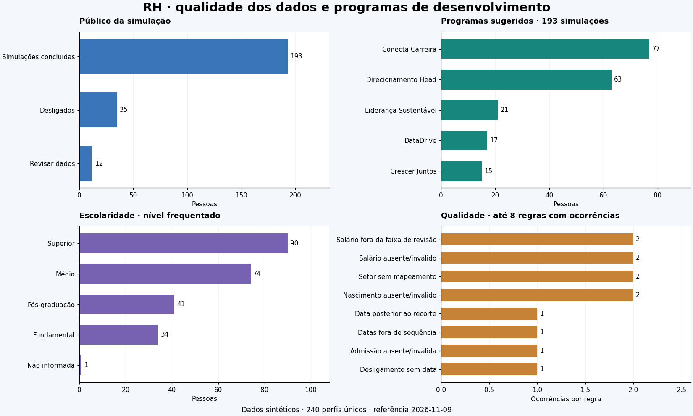

# RH · qualidade de dados e programas de desenvolvimento

Projeto em Python que transforma uma base cadastral de RH em uma análise exploratória e uma simulação explicável de programas de desenvolvimento. O notebook apresenta o diagnóstico, preserva a entrada e mostra os critérios usados em cada sugestão.

[Abrir o notebook](notebooks/01_qualidade_e_programas_rh.ipynb) · [Executar no Colab](https://colab.research.google.com/github/Assoridente/Projeto-RH/blob/main/notebooks/01_qualidade_e_programas_rh.ipynb)



## Objetivo

Explorar como a qualidade dos dados afeta uma segmentação por regras. A demonstração usa 240 perfis inteiramente sintéticos e uma duplicata intencional para exercitar o tratamento. A data de referência é `2026-11-09` e a geração usa semente `42`.

As sugestões são produzidas por critérios manuais de contrato, setor, escolaridade, tempo de casa, idade e salário. O projeto expõe a pontuação, as justificativas e os empates para revisão das hipóteses com RH.

## O que foi melhorado

| Etapa | Comportamento desta versão |
|---|---|
| Origem | Colunas recebidas preservadas, com campos tratados adicionados ao lado |
| Escolaridade | Mapeamento explícito pela descrição, mantendo a distinção do nível frequentado |
| Salário | Leitura de números e moeda brasileira, com sinalização de problemas |
| Datas | Valores ausentes e inválidos sinalizados, sem datas estimadas |
| Idade e tempo de casa | Anos completos pela data do aniversário |
| Cargos | Associação ao setor antes do agrupamento por frequência |
| Público | Pessoas desligadas separadas da simulação de programas |
| Pontuações | Critérios e pesos visíveis, com indicação dos empates |
| Reexecução | Recusa de uma fonte que já contenha colunas derivadas |
| Verificação | Testes dos erros identificados no protótipo e execução integral do notebook |

## Resultado da demonstração

| Medida | Quantidade |
|---|---:|
| Linhas recebidas | 241 |
| Perfis únicos após tratamento | 240 |
| Perfis com alguma pendência | 15 |
| Simulações concluídas | 193 |
| Pessoas desligadas na fotografia fictícia | 35 |
| Perfis com vínculo que aguardam revisão | 12 |
| Simulações com empate | 13 |

Três dos 15 perfis com pendências também estão entre os desligados. As contagens de qualidade e de público se sobrepõem.

Entre as 193 simulações concluídas, 77 receberam Conecta Carreira, 63 Direcionamento Head, 21 Liderança Sustentável, 17 DataDrive e 15 Crescer Juntos. Esses números descrevem a base fictícia gerada para o estudo.

## Executar localmente

Use Python 3.10 ou superior. No Windows, a execução pode ser feita em um ambiente virtual.

```powershell
git clone https://github.com/Assoridente/Projeto-RH.git
cd Projeto-RH
python -m venv .venv
.\.venv\Scripts\python.exe -m pip install -r requirements.txt
.\.venv\Scripts\python.exe executar_notebook.py
.\.venv\Scripts\python.exe -m unittest discover -s tests -v
```

No Linux ou macOS, use `.venv/bin/python` no lugar de `.venv/Scripts/python.exe`.

O script executa todas as células e salva o notebook após a conclusão bem-sucedida. A figura de visão geral é gerada em `docs/imagens`. Os resultados tabulares podem ser exportados para `outputs` ativando `EXPORTAR_RESULTADOS` no notebook.

## Organização

```text
notebooks/01_qualidade_e_programas_rh.ipynb  Análise executada com exemplos e gráficos
src/rh_programas.py                         Tratamento e regras de simulação
src/gerar_dados_sinteticos.py                Geração reproduzível dos perfis fictícios
config/mapeamentos.json                     Dicionários de cargos e escolaridade
data/sinteticos/base_rh_sintetica.csv         Entrada demonstrativa
docs/metodologia.md                         Regras, critérios e limites de interpretação
docs/dicionario-de-dados.md                  Contrato de entrada e campos calculados
tests/test_tratamento.py                    Verificações de regressão
executar_notebook.py                        Execução integral em um kernel Python
requirements.txt                           Versões das dependências principais
```

## Uso dos dados

A base pública foi criada por código, com IDs `SINT-...` e nomes `Pessoa sintética ...`. As frequências, salários, datas e situações são fictícios. O gerador parte de listas fixas de cargos e escolaridades e de escolhas aleatórias com semente.

Para estudar uma nova base local, use os campos de origem descritos no [dicionário](docs/dicionario-de-dados.md). A rotina rejeita arquivos com colunas como `Programa`, `score_retencao` ou `idade`, pois transformações anteriores podem ter alterado as datas e salários. A pasta `data` admite no versionamento somente o CSV sintético deste projeto.

## Interpretação

Os pesos precisam de validação de RH, inclusive os critérios de idade e salário e a prioridade usada nos empates. `pontuacao_perfil_exploratorio` é uma combinação manual de características e não foi calibrada contra desligamentos observados. As decisões sobre participação em programas exigem avaliação das pessoas responsáveis pelo processo.

O [documento de metodologia](docs/metodologia.md) explica as regras e as suposições. A análise usa a situação cadastral recebida como fotografia. Uma data de referência histórica, sozinha, não reconstrói a situação passada de cada pessoa.
